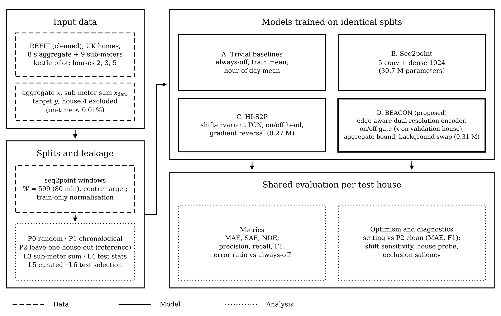

# BEACON: Cross-Building NILM under a Leakage-Free Benchmark

Code and results for the article:

> Sukkuea, A.; Tharu, N.K.; Akkajit, P. **BEACON: A Background-Swap, Event-Gated Network for Cross-Building Non-Intrusive Load Monitoring under a Leakage-Free Benchmark.** *Machine Learning and Knowledge Extraction* (submitted, 2026).

## What is in this repository

| Path | Content |
|---|---|
| `NILM_BEACON_Benchmark_REFIT.ipynb` | Single notebook: data loading, split protocols P0–P2, leakage variants L3–L6, baselines, seq2point, HI-S2P, BEACON, statistics and knowledge-extraction diagnostics |
| `results/kettle_pilot/` | Raw per-run results (`results_kettle.csv`), summaries, statistics, house statistics and figures of the pilot reported in the article |
| `figures/` | Figures 1–8 of the article and the graphical abstract |

## Running the benchmark

1. Open the notebook in Google Colab and select a GPU runtime (T4 or better).
2. Data: the notebook downloads the cleaned REFIT dataset (Murray et al., *Sci. Data* 2017, CC BY 4.0, <https://doi.org/10.15129/9ab14b0e-19ac-4279-938f-27f643078cec>). If the Strathclyde server blocks the download, download `CLEAN_REFIT_081116.7z` in a browser and place it in `MyDrive/refit/`. The Zenodo mirror (record 5063428, houses 1–5 and 11) is used as a fallback.
3. `QUICK = True` reproduces the pilot in the article (kettle, houses 2, 3 and 5, one seed, five epochs, two LOHO test houses). `QUICK = False` runs the full configuration (five appliances, all REFIT houses, three seeds, 20 epochs, ablations).
4. Results are written to `OUT_DIR` after every run, so an interrupted session resumes where it stopped.

Re-running the notebook with `QUICK = True` and seed 0 reproduced every metric in `results/kettle_pilot/results_kettle.csv` exactly.

## Requirements

Python 3.10+, PyTorch 2.x with CUDA, NumPy, pandas, SciPy, scikit-learn, Matplotlib, requests (see `requirements.txt`). Part B (optional REFIT → UK-DALE test) additionally needs PyTables.

## Citation

If you use this code, please cite the article (see `CITATION.cff`).

## License

Code: MIT License (see `LICENSE`). The REFIT data are not redistributed here and remain under their original CC BY 4.0 licence.
